# 

  

---

### 🎮 Character Status & Vitals (HUD)

  

  
<b>📡 Fast-Travel & Guild Comms Portals (Click to Toggle)</b>

   

<table>
  <tr>
    <td align="center" width="33%">
      <a href="https://linkedin.com/in/inusha-gunasekara-9996632a5" target="_blank">
         
        <b><code>in/inusha-gunasekara</code></b>
      </a>
    </td>
    <td align="center" width="33%">
      <a href="mailto:inusha.thathsara@gmail.com">
         
        <b><code>inusha.thathsara@gmail.com</code></b>
      </a>
    </td>
    <td align="center" width="33%">
      <a href="https://dev.to/inushathathsara" target="_blank">
         
        <b><code>dev.to/inushathathsara</code></b>
      </a>
    </td>
  </tr>
  <tr>
    <td align="center" width="33%">
      <a href="https://facebook.com/InushaThathsara" target="_blank">
         
        <b><code>InushaThathsara</code></b>
      </a>
    </td>
    <td align="center" width="33%">
      <a href="https://instagram.com/inusha_thathsara" target="_blank">
         
        <b><code>@inusha_thathsara</code></b>
      </a>
    </td>
    <td align="center" width="33%">
      <a href="https://www.google.com/maps/place/Colombo,+Sri+Lanka" target="_blank">
         
        <b><code>Colombo, Sri Lanka 🇱🇰</code></b>
      </a>
    </td>
  </tr>
</table>

---

### 🏆 Guild Trophies & Milestones

  

---

### ⚔️ Arsenal & Skill Tree

<table>
  <tr>
    <td width="25%" align="center"><b>Category</b></td>
    <td width="75%" align="center"><b>Equipped Spells & Runes</b></td>
  </tr>
  <tr>
    <td align="center"><b>🔮 Frontend Grimoire</b></td>
    <td>
      
      
      
      
      
      
      
    </td>
  </tr>
  <tr>
    <td align="center"><b>⚙️ Backend Forge</b></td>
    <td>
      
      
      
      
      
      
    </td>
  </tr>
  <tr>
    <td align="center"><b>🧠 AI & Alchemy</b></td>
    <td>
      
      
      
      
      
    </td>
  </tr>
  <tr>
    <td align="center"><b>🛡️ Artifacts & Utilities</b></td>
    <td>
      
      
      
      
      
      
    </td>
  </tr>
</table>

  

---

### 🗺️ Legendary Quests (Featured Artifacts)

<table>
  <tr>
    <td width="50%" valign="top">
      <h3 align="center">🦥 slothpfn</h3>
      

        
      

      
<b>Quest Log:</b> Zero-Effort Tabular AI Agent powered by Prior Labs TabPFN foundation model and ElevenLabs Voice AI. Built for Hacktoberfest Week 3.

      
<b>Loot Drops:</b> <code>Python</code> <code>TabPFN</code> <code>ElevenLabs Voice AI</code> <code>Autonomous Agent</code>

    </td>
    <td width="50%" valign="top">
      <h3 align="center">👻 ghost-data-audit-agent</h3>
      

        
      

      
<b>Quest Log:</b> Autonomous Deletion-Audit Agent for GDPR/CCPA Compliance across Distributed Enterprise Systems. Built for HackerRank Orchestrate.

      
<b>Loot Drops:</b> <code>Python</code> <code>Distributed Systems</code> <code>Compliance AI</code> <code>Auditing</code>

    </td>
  </tr>
  <tr>
    <td width="50%" valign="top">
      <h3 align="center">🎙️ podsnippet-studio</h3>
      

        
      

      
<b>Quest Log:</b> Open-source AI podcast & audio teaser engine for technical writers with Gemma 2 and ElevenLabs. Built for Hacktoberfest Week 2.

      
<b>Loot Drops:</b> <code>JavaScript</code> <code>Gemma 2</code> <code>ElevenLabs</code> <code>Audio Synthesis</code>

    </td>
    <td width="50%" valign="top">
      <h3 align="center">⚡ Gemmate</h3>
      

        
      

      
<b>Quest Log:</b> Open-source voice study companion for cracking exam traps powered by Google Gemma & ElevenLabs. Built for DEV Hacktoberfest 2026.

      
<b>Loot Drops:</b> <code>TypeScript</code> <code>Google Gemma</code> <code>ElevenLabs</code> <code>Voice Agent</code>

    </td>
  </tr>
  <tr>
    <td width="50%" valign="top">
      <h3 align="center">📑 documind</h3>
      

        
      

      
<b>Quest Log:</b> Intelligent Real-Time AI Documentation & Technical Knowledge Agent powered by Next.js 15, Sanity CMS, and Google Gemini AI.

      
<b>Loot Drops:</b> <code>Next.js 15</code> <code>Google Gemini</code> <code>Sanity CMS</code> <code>Full-Stack</code>

    </td>
    <td width="50%" valign="top">
      <h3 align="center">📐 the-living-blueprint-agent</h3>
      

        
      

      
<b>Quest Log:</b> AI-powered Process-to-Document Partner for Engineering Architecture Design, PRDs, and Threat Models. Built for All Things Agentic Hackathon.

      
<b>Loot Drops:</b> <code>Python</code> <code>Agentic Workflows</code> <code>Architecture</code> <code>LLM PRD</code>

    </td>
  </tr>
</table>

---

### 📊 Combat Telemetry & Git Stats

  
  

  

---

### 🐍 The Dungeon Grid (Combat Activity)

  

---

  

